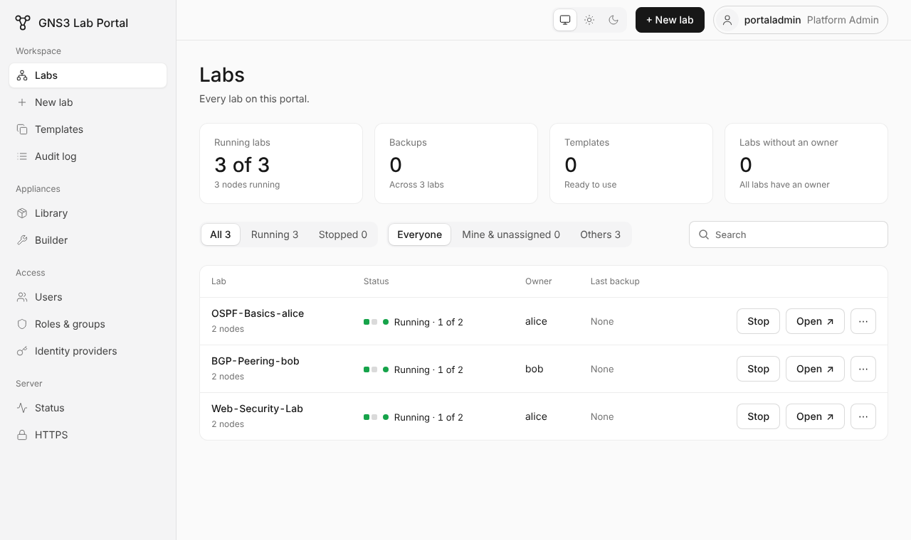
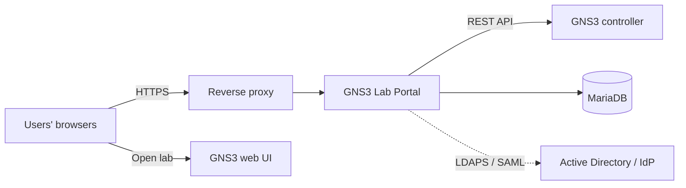

# GNS3 Lab Portal

[](https://github.com/dhavalsoni88/GNS3-Lab-portal/actions/workflows/ci.yml)
[](LICENSE)

A self-hosted web portal that lets teams create, run, back up, share and reuse
[GNS3](https://www.gns3.com/) network labs without giving everyone direct
access to the GNS3 controller.

The portal sits in front of a GNS3 server. Users sign in, see only the labs
they own or that were shared with them, and open each lab in the GNS3 web
interface with one click. Administrators manage users, roles, templates and
storage from the same place, and every action is audited.



## Features

- **Labs.** Create empty labs, or start them from templates or backups. Start
  and stop all nodes, rename a lab and export it. The labs list shows status,
  node counts and the last backup.
- **Safe backups.** A backup stops a lab's nodes, waits until GNS3 confirms
  they are off, then takes a native snapshot. Progress shows in the browser,
  and the job can be cancelled. Backups can be restored, downloaded or turned
  into a new lab.
- **Sharing and templates.** Share a lab with other users, or share a backup
  so someone can make one copy of it. Publish a backup as a template that
  anyone can start from, optionally after approval.
- **Retained backups.** Keep chosen backups in an archive when a lab is
  deleted, with a per-user limit.
- **Roles.** Platform Admin, Lab Manager, Template Approver, Lab Editor, Lab
  Operator, Viewer and Auditor, enforced on every action.
- **Sign-in options.** Local accounts, Active Directory over LDAPS, and SAML
  2.0 single sign-on for Microsoft Entra ID, Okta and ADFS. Directory and SSO
  groups map to roles. A local break-glass administrator always works.
- **Audit.** Every portal action is recorded with its user, source IP and
  result. The audit tables are append-only, every change to users,
  roles, ownership and sharing is kept with its old and new values, and
  MariaDB's own audit plugin logs connections and schema changes.
- **Storage.** Optional placement of native snapshots on a separate disk,
  keeping running labs on fast storage.
- **Operations.** Live CPU, memory and disk I/O for administrators, rotating
  portal and GNS3 API logs, and a MariaDB database.

## How it works



All controller API calls come from the portal's backend, so browsers never
need to reach the GNS3 API. Opening a lab hands the user to the GNS3 web
interface for topology editing.

## Quick start

On an Ubuntu server that already runs GNS3:

```bash
sudo git clone https://github.com/dhavalsoni88/GNS3-Lab-portal.git /opt/gns3-lab-portal
cd /opt/gns3-lab-portal
sudo python3 -m venv .venv
sudo .venv/bin/pip install -r requirements.txt
sudo bash scripts/setup-mariadb.sh   # database, accounts and schema; prints the PORTAL_DB_* lines
sudo cp .env.example .env    # then edit GNS3_URL, credentials, PORTAL_SECRET_KEY and PORTAL_DB_*
sudo install -m 644 deploy/systemd/gns3-lab-portal.service /etc/systemd/system/
sudo systemctl daemon-reload && sudo systemctl enable --now gns3-lab-portal
```

The service listens on `127.0.0.1:8088`. Publish it through an HTTPS reverse
proxy (an [Nginx example](deploy/nginx/gns3-lab-portal.conf) is included).
The full walkthrough, including data directories and storage permissions, is
in the [installation guide](docs/installation.md).

To upgrade an existing server, including one still on SQLite:

```bash
sudo git -C /opt/gns3-lab-portal pull --ff-only
sudo bash /opt/gns3-lab-portal/scripts/upgrade.sh
```

## Documentation

| Guide | Covers |
|---|---|
| [Architecture](docs/architecture.md) | Components, data, main flows, security model, design decisions |
| [Installation](docs/installation.md) | Prerequisites, install, service, reverse proxy, verification |
| [Configuration](docs/configuration.md) | Every `.env` setting |
| [Administrator guide](docs/admin-guide.md) | Day-to-day administration, security checklist, maintenance |
| [User guide](docs/user-guide.md) | Labs, backups, sharing, templates, retained backups |
| [Authentication](docs/authentication.md) | Roles, local accounts, Active Directory, Entra ID, Okta, ADFS |
| [Database](docs/database.md) | MariaDB schema, audit layer, accounts, backups |
| [Storage](docs/storage.md) | Snapshot storage on a separate disk, permissions |
| [Operations](docs/operations.md) | Logs, monitoring, safeguards, troubleshooting |
| [Upgrading](docs/upgrading.md) | Updating an installation; moving from SQLite to MariaDB |
| [Engineering guide](docs/engineering.md) | Code map, development setup, making changes, releasing |
| [Roadmap](docs/roadmap.md) | Delivered and planned phases |
| [Changelog](CHANGELOG.md) | Release history |

## Project status

The current release line is **v8.6**, in production use. **v9.0** is in
development on this branch. It runs on MariaDB only; existing SQLite
installs move with a verified script ([upgrading](docs/upgrading.md#moving-from-sqlite-to-mariadb)).
The database layer, audit logging, the new
interface, roles, Active Directory and SSO are complete. Multi-server
clusters, the one-step installer and on-demand AWS servers are next. See the
[roadmap](docs/roadmap.md).

## Development

```bash
python3 -m venv .venv && . .venv/bin/activate
pip install -r requirements.txt -r requirements-dev.txt
PORTAL_DB_HOST=localhost PORTAL_DB_USER=root python -m pytest   # needs a throwaway MariaDB
```

See the [engineering guide](docs/engineering.md) and
[CONTRIBUTING.md](CONTRIBUTING.md).

## Security

The portal controls access to labs through its own interface. Firewall the
GNS3 API (port 3080) so only the portal host can reach it. Do not publish the
GNS3 web interface to users you would not trust with the whole controller.
Report vulnerabilities privately as described in [SECURITY.md](SECURITY.md).

## License

[MIT](LICENSE). GNS3 is a separate project with its own licence; this portal
only talks to its REST API.
