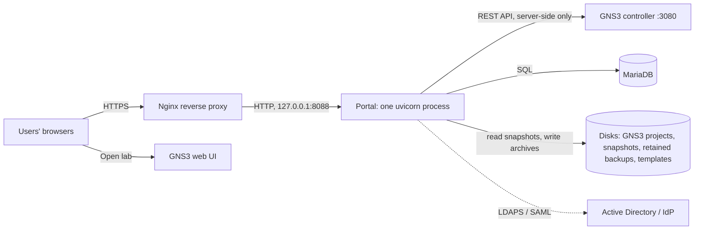

# Architecture

This page explains how the portal is built and why. It is for architects,
security reviewers and engineers who are new to the code.

## Context

The portal is a gatekeeper in front of one GNS3 controller. Browsers never
call the GNS3 API: every controller call carries the portal's own GNS3
credentials, and the portal decides who may make it. Topology editing still
happens in the GNS3 web interface, which is why port 3080 must be firewalled
from ordinary users (see [Security model](#security-model)).

## Components

| Part | Job |
|---|---|
| [`app.py`](../app.py) | FastAPI application: every page and form, the permission checks, calls to GNS3, and the background backup and import jobs. |
| [`portal_auth.py`](../portal_auth.py) | Roles and permissions, Active Directory sign-in over LDAPS, SAML 2.0 single sign-on, and encryption of stored provider secrets. |
| [`portal_db.py`](../portal_db.py) | MariaDB access: one short connection per unit of work, the audit request context, and schema migrations. |
| [`database/mariadb/`](../database/mariadb/) | Numbered schema migrations, including the append-only and change-history triggers. |
| `templates/`, `static/` | Server-rendered Jinja pages and one stylesheet. No front-end build step. |
| [`scripts/`](../scripts/) | MariaDB setup, the SQLite-to-MariaDB move, and moving snapshots to a separate disk. |
| [`deploy/`](../deploy/) | systemd unit and Nginx example. |

## Where data lives

| Data | Stored in | Notes |
|---|---|---|
| Users, roles, sessions, lab owners, shares, templates, retained-backup records, identity providers, group mappings | MariaDB | The source of truth for access. Back it up (see [database.md](database.md#backing-up-the-database)). |
| Audit log and change history | MariaDB | Append-only; triggers reject updates and deletes. |
| Labs and their native snapshots | GNS3 project folders (optionally a separate snapshot disk) | Owned by GNS3. The portal only reads snapshot files. |
| Retained backups, template archives | `RETAINED_BACKUP_DIR`, `LAB_TEMPLATE_DIR` | Copies the portal owns, so they survive deletion of the source lab. |
| Uploads in progress, profile photos | `data/uploads`, `data/avatars` | Uploads are deleted after import. |
| Session epoch, job progress, SSO request IDs, failed sign-in counts | Portal process memory | Lost on restart, by design. This is why only one process may run. |

## Main flows

**Each request.** Middleware records the source IP (from `X-Forwarded-For`
only when the request comes from a trusted proxy), the browser and a request
ID. The cookie holds only a random session token, signed with
`PORTAL_SECRET_KEY`. The portal looks the token's hash up in
`portal_sessions` once per request. It checks idle time, total age and the
process epoch, then loads the user and their roles. Permissions are the union
of the user's roles; lab access also needs ownership, a share, or the
`labs.all` permission.

**Sign-in.** Local accounts are checked against Argon2id hashes. If no local
account matches, each enabled LDAP directory is tried: a service account
finds the user, then the user's own password is bound. SAML sign-in must
start at the portal: the response must answer a request the portal sent,
and each assertion is accepted once. Directory and SSO users get roles from
group mappings at every sign-in. An external identity can never take over a
local account. Five failures for one name from one address lock that pair
for 15 minutes.

**Backup.** The form starts a background job and returns at once; the
browser polls its status. The job opens the project, stops emulated nodes,
waits until GNS3 reports them stopped, then asks GNS3 for a native snapshot.
A cancel before the snapshot starts stops the job. A cancel during the
snapshot lets GNS3 finish, then deletes the result. While a backup runs,
start, stop, restore, delete and backup actions on that lab are refused.

**New lab from a backup, template or upload.** One import runs at a time.
The job checks that the source file is inside its expected folder, streams it
to GNS3 as a new project ID, assigns the owner and, for a shared backup, uses
up the share.

**Delete a lab and keep backups.** Every chosen snapshot file is found and
copied first. Their records are then written together. Only after that is
the lab deleted, so a failure leaves the lab and the user's quota untouched.

## Security model

- **Trust boundaries:** the browser (untrusted), the reverse proxy (trusted
  for client IP only), GNS3 (trusted, reached with service credentials),
  MariaDB (trusted), and the directory and IdP (trusted for identity and
  groups).
- **Fail closed at start-up:** the portal refuses to start with a
  placeholder or short `PORTAL_SECRET_KEY`, with pending migrations, with a
  database setting other than MariaDB, or with an empty MariaDB next to an
  old SQLite file. Sign-in is on unless explicitly turned off.
- **Forged requests:** session cookies are `SameSite=Lax` and every change is
  a POST, so other sites cannot submit forms as a signed-in user.
- **Least privilege in MariaDB:** the runtime account cannot change the
  schema and can only insert into audit tables; a separate account runs
  migrations, and an auditor account reads audit tables only.
- **Secrets:** directory bind passwords are encrypted with a key derived
  from `PORTAL_SECRET_KEY`. Passwords and tokens are never logged or audited.
- **GNS3 web interface:** users who reach port 3080 bypass the portal
  completely. Firewall it.

## Decisions

**MariaDB only (v9.0).** SQLite served single servers well, but it allowed
two schemas to drift apart, could not make the audit log tamper-resistant,
and blocks the multi-server roadmap. Supporting one database removes the
SQLite schema code and the second test run, and lets the audit design rely
on triggers and least-privilege accounts everywhere. Existing installs move
with a verified, re-runnable script ([upgrading.md](upgrading.md#moving-from-sqlite-to-mariadb)).

**One SQL style.** Queries keep `?` placeholders and `ON CONFLICT` upserts,
and `portal_db.translate_for_mariadb` rewrites them. This kept the move to
MariaDB-only small and low-risk. Rewriting every query in native MariaDB
syntax would add risk and change nothing visible.

**Jobs in process memory.** Backups and imports run as tasks inside the
portal process, and their progress lives in memory. This needs no queue
service and fits one server. The cost: a restart forgets running jobs, and
the portal must run as one process.

## Limits and what comes next

Designed for one portal server in front of one GNS3 controller, with tens of
users and up to a few hundred labs. A dashboard load makes about ten database
queries plus one per published template, and two GNS3 calls per lab
(measured: 11 queries for 50 labs).

Before running several portal servers (the cluster phase in the
[roadmap](roadmap.md)), these items must move from process memory to
MariaDB: the session epoch, job progress, SAML request IDs and failed
sign-in counts. Each is marked with a `shortcut:` comment in the code.
