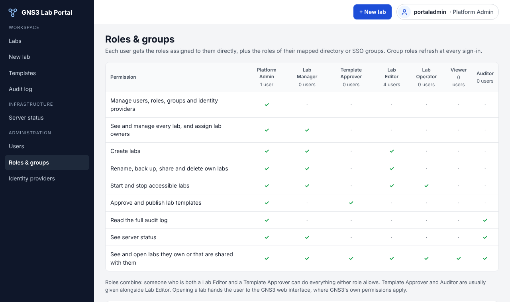
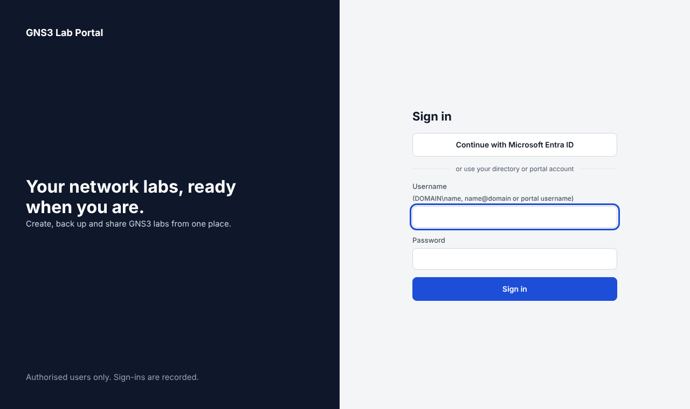

# Authentication and roles

## Roles

Every account has one or more roles. Roles combine: a user who is both a Lab
Editor and a Template Approver can do everything either role allows.

| Permission | Platform Admin | Lab Manager | Template Approver | Lab Editor | Lab Operator | Viewer | Auditor |
|---|:-:|:-:|:-:|:-:|:-:|:-:|:-:|
| Manage users, roles, groups and identity providers | ✓ | | | | | | |
| See and manage every lab; assign owners | ✓ | ✓ | | | | | |
| Create labs | ✓ | ✓ | | ✓ | | | |
| Rename, back up, share and delete own labs | ✓ | ✓ | | ✓ | | | |
| Start and stop accessible labs | ✓ | ✓ | | ✓ | ✓ | | |
| Approve and publish templates | ✓ | | ✓ | | | | |
| Read the full audit log | ✓ | | | | | | ✓ |
| See server status | ✓ | ✓ | | | | | ✓ |

Everyone can see and open the labs they own or that are shared with them.
Restoring or deleting backups, and deleting a lab, need the lab's owner or a
Lab Manager.

**Administration › Roles & groups** shows the same table, with how many users
hold each role.

When upgrading from v8.x, Administrators become Platform Admins and users
become Lab Editors.

A role controls what someone can do **in the portal**. **Open in GNS3** hands
the user to the GNS3 web interface, where GNS3's own permissions apply, so do
not expose the GNS3 web interface to people you would not trust with the
whole controller.

## Sign-in methods

Users can sign in three ways. Local accounts always work; the other two are
set up under **Administration › Identity providers**.

### Local accounts

Created on the Users page with a temporary password of at least 12
characters. Passwords are stored as Argon2id hashes. Older v8.x scrypt hashes
are upgraded automatically at the user's next sign-in.

At least one **enabled local Platform Admin** must always exist. The portal
refuses to disable or demote the last one, so you can sign in even when every
directory and SSO provider is down.

### Active Directory over LDAPS

1. Choose **+ Active Directory (LDAPS)**.
2. Enter the `ldaps://` URL using the host name on the domain controller's
   certificate, for example `ldaps://dc01.corp.example.com:636`. Plain LDAP is
   not offered.
3. Paste the enterprise root CA, plus any intermediates, in PEM format. An
   untrusted, expired or mismatched certificate is refused.
4. Enter a read-only service account's DN and password. The password is
   stored encrypted with a key derived from `PORTAL_SECRET_KEY`.
5. Set the user search base and, for group search, the group search base.
   The default filter matches `sAMAccountName` or `userPrincipalName`.
6. Save, then use **Test the connection** with a sample user.
7. Map groups to roles (below), then tick **Enabled**.

Users sign in on the normal form as `DOMAIN\name`, `name@domain` or `name`.
Their password goes only to the directory; it is never stored. With
**Include nested groups**, membership through nested groups counts.

### SAML 2.0 single sign-on

Supported presets: **Microsoft Entra ID**, **Okta**, **ADFS** and any SAML 2.0
provider.

1. Set `PORTAL_PUBLIC_URL` in `.env` to the portal's `https://` address and
   restart.
2. Choose **+ Single sign-on (SAML)** and your provider, then save it.
3. Give your identity provider the **Identifier (Entity ID)** and **Reply
   URL** shown on the provider's page, or the SP metadata file.
4. Paste the identity provider's federation metadata XML into the portal and
   save again.
5. Map groups to roles, then enable the provider. A **Continue with …** button
   appears on the sign-in page.

Provider-specific steps:

- **Entra ID**: Enterprise applications › New application › Create your own
  application (non-gallery) › Single sign-on › SAML. Add a groups claim for
  security groups. Entra sends group **object IDs**, so map groups by object ID.
  Assign only the groups the portal needs: Entra stops sending the list when a
  user is in more than 150 groups.
- **Okta**: Applications › Create App Integration › SAML 2.0. Add a group
  attribute statement named `groups`.
- **ADFS**: add a relying party trust from the portal's SP metadata URL. Add
  claim rules for UPN, email address, given name, surname and Group.

Security behaviour:

- The identity provider must sign assertions.
- Each response must answer a sign-in started from the portal, so
  IdP-initiated sign-in is refused.
- A response can be used once.
- Pending sign-ins are kept in memory for ten minutes, so a portal restart
  during a sign-in means starting again.
- Signing out of the portal does not sign the user out of the identity
  provider.

## Group-to-role mapping

On each provider's page, map a group to a role:

- For AD, use the group's distinguished name. **Find directory groups**
  searches the directory for you.
- For SAML, use the group value the provider sends.

Group roles are refreshed at every sign-in. A user's roles are the ones
assigned directly on the Users page plus the ones from their groups.

A directory or SSO user whose groups map to no role, and who has no role
assigned directly, cannot sign in, unless the provider has a **Role for
members of unmapped groups**. When that happens the user also loses any roles
they had from groups.

A directory or SSO sign-in can never take over an existing local account, or
another provider's account, with the same username. Directory and SSO users
cannot use a portal password.

## Sessions

Sessions are stored on the server; the browser holds only a random token.
A session ends:

- after 30 minutes without activity, or 8 hours in total (set
  `PORTAL_SESSION_IDLE_SECONDS` and `PORTAL_SESSION_MAX_SECONDS` to change);
- when the user signs out;
- when the same user signs in again elsewhere;
- when the portal restarts.

Set `PORTAL_COOKIE_SECURE=true` once the portal is served over HTTPS.
