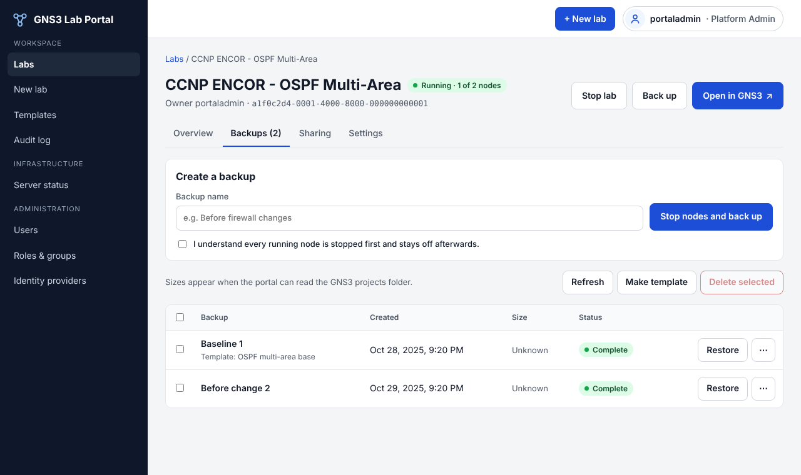

# User guide

What you can do depends on your role; see [authentication.md](authentication.md#roles).
Buttons you are not allowed to use are not shown.

## Labs

**Labs** lists the labs you own and the labs shared with you. Lab Managers and
Platform Admins see every lab and can filter by owner. Each row shows:

- **Status**: *Running · 2 of 4* means two of four emulated nodes are on. GNS3
  Cloud and built-in Ethernet switch nodes are always on and are not
  counted.
- **Owner** (managers only). *Needs an owner* marks a lab created outside the
  portal; assign one from the row's ⋯ menu.
- **Last backup**, shown in your browser's time zone.

Row actions:

- **Start** or **Stop** turns all emulated nodes on or off. Both are blocked
  while the lab is being backed up.
- **Open** opens the lab in the GNS3 web interface in a new tab. Topology
  editing happens there.
- **⋯** lets you rename, share, change the owner (managers) or go to the lab
  page.

Use the status chips and the search box to narrow the list.

## Creating a lab

**New lab** offers four starting points:

- **Empty lab**: a blank GNS3 project.
- **From a template**: a copy of an approved template.
- **From a backup**: a copy of a backup of one of your labs, of a backup shared
  with you, or of a retained backup from a deleted lab.
- **Upload a backup file**: a `.gns3snapshot` or `.gns3project` from your
  computer.

Labs made from backups or templates are separate copies with new IDs. They
start powered off, and the source is never changed. Progress is shown while
the copy is made.

New labs belong to the person who created them.

## The lab page

Select a lab's name to open its page. The tabs are:

- **Overview**: nodes and their state and console, the latest backup and who
  the lab is shared with.
- **Backups**: create, restore, download, share and delete backups, or make a
  template.
- **Sharing**: give other users access to the lab.
- **Settings**: rename, export a portable archive, or delete the lab.

### Backups

**Stop nodes and back up** stops every running node, waits until GNS3
confirms each is off, then creates a native GNS3 snapshot. Nodes stay off
afterwards. You must tick the confirmation box first.

The backup runs in the background and the page shows its progress. GNS3 does
not report byte-level progress, so the percentage during the snapshot itself
is an estimate. Leaving the page does not stop the backup.

To cancel, hover the progress ring and select it. Before GNS3 starts writing,
the job simply stops. Once GNS3 has started writing, it cannot be
interrupted. The portal lets it finish, then deletes the result.

From each backup's ⋯ menu you can download the backup file, create a new lab
from it, or share it once with another user.

**Restore** replaces the lab's current state with the backup. Restoring and
deleting backups are limited to the lab's owner and Lab Managers.

Select backups with the checkboxes to delete several at once.

Native snapshots live on the GNS3 server; they are not disaster-recovery
copies. Use **Settings › Export** or a scheduled copy to separate storage for
that.

## Sharing

**Sharing a lab** gives another user access to it. They see it in their labs
list and can open, start and stop it. Their role decides whether they can back
it up. They cannot delete it or share it further. Only the owner or a Lab
Manager can change sharing.

**Sharing a backup** gives someone a single-use starting point. They do not get
access to your lab. Instead, the backup appears under **New lab › From a
backup › Backups shared with you**, and once they create a lab from it, the
share is used up. A failed attempt leaves it available.

## Templates

A template is a backup published for everyone to start from. On the lab's
**Backups** tab, select exactly one backup, then choose **Make template**.

- Templates created by a Template Approver or Platform Admin are published at
  once.
- Anyone else's go to **Templates › Waiting for approval** until an approver
  publishes or rejects them.

The portal copies the backup into its own template archive and verifies it,
so a template survives deletion of its source lab and backup. Unpublishing a
template removes that copy.

## Retained backups

When you delete a lab, you can choose backups to keep in your retained-backup
archive. Each user may keep two by default. An administrator can change your
allowance on the Users page. Retained backups appear under **New lab › From a
backup**. Lowering an allowance never deletes existing copies; it only blocks
new ones.

## Activity and profile

**My activity** lists your own actions. People with the Auditor or Platform
Admin role see the full **Audit log**, including source IP addresses and
failed sign-ins.

**My profile** holds your name, email and photo (JPG, PNG or WebP, up to
2 MiB). Local-account users can change their password there. Usernames cannot
change because they identify lab ownership.

## View as user

A Platform Admin can choose **View as user** on the Users page to see the
portal exactly as that person does. A banner stays visible throughout, and
audit entries record the administrator as
`admin impersonating user`.
